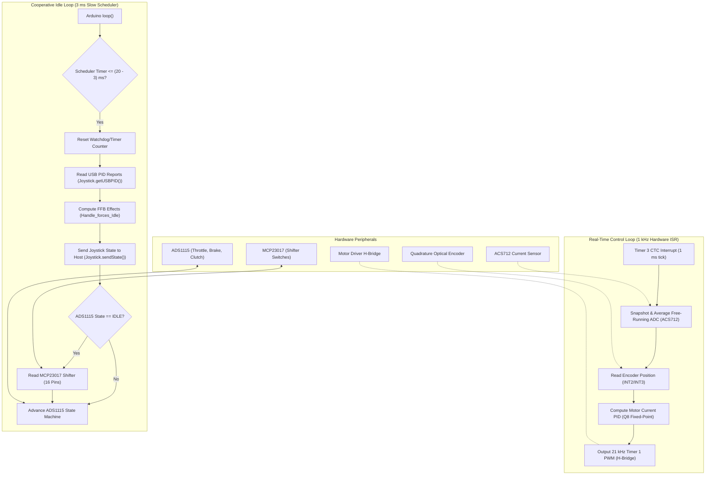
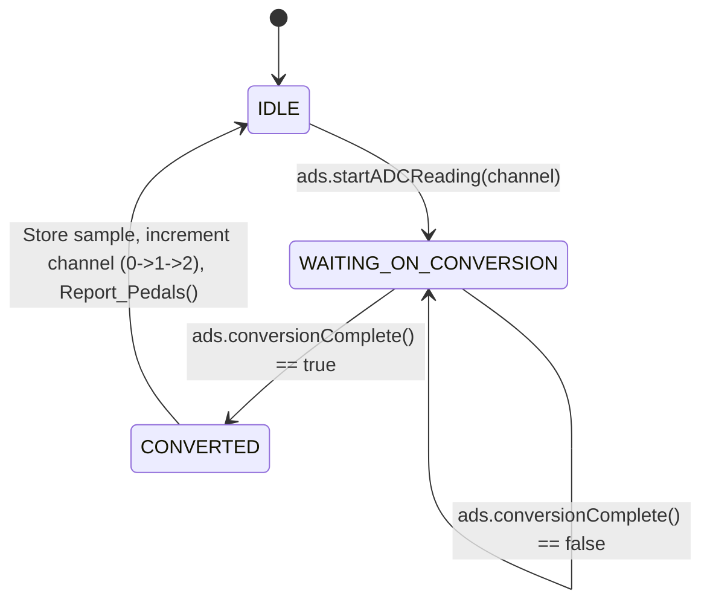

# Firmware Architecture & Timing Guide

This document describes the internal software architecture, real-time control loops, sensor acquisition pipelines, and hardware scheduling of the **GearShifterForMargus** firmware for the Arduino Leonardo (ATmega32U4).

---

## 1. System Overview & Data Flow

The firmware is designed around a **dual-rate execution model**:
1. **A strict 1 kHz Hardware Timer ISR** dedicated to time-critical motor current control, encoder decoding, and ADC sample averaging.
2. **A cooperative 3 ms Idle Loop** dedicated to USB HID communication, DirectInput FFB floating-point math, and non-blocking I2C bus arbitration.



---

## 2. Dual-Rate Execution Model

The ATmega32U4 has a single 8-bit core running at 16 MHz. To deliver high-fidelity force feedback without jitter while simultaneously polling high-resolution 16-bit I2C sensors and servicing USB HID reports, the tasks are partitioned across two timing layers:

### A. 1 kHz Real-Time Interrupt (`TIMER3_COMPA_vect`)
- **Timer Configuration:** Timer 3 is initialized in Clear Timer on Compare Match (CTC) mode with a prescaler of 64:
  $$\text{Tick Frequency} = \frac{16\,\text{MHz}}{64 \times (249 + 1)} = 1000\,\text{Hz}\quad (1\,\text{ms})$$
- **Responsibilities:**
  - Decrements the cooperative scheduler counter `SchedulerTimer`.
  - Atomically snapshots and resets accumulated ADC samples gathered by the free-running ADC ISR (`ACS712_snapshotAndClear`).
  - Obtains current wheel encoder tick count (`Get_CurrentPosition()`).
  - Updates ACS712 current PID regulator and drives motor PWM duty cycle (`Motor_set()`).
- **Design Rule:** The ISR execution time is kept strictly below $150\,\mu\text{s}$ using integer Q8 fixed-point math to leave $>85\%$ CPU bandwidth for the main thread and USB stack.

### B. 3 ms Cooperative Idle Loop (`loop()`)
- Runs when the 1 kHz ISR decrements `SchedulerTimer` by 3 counts (`WATCHDOG_TIMER - SLOW_SCHEDULER_TIMER`).
- **Responsibilities:**
  - Receives DirectInput FFB packets (`Joystick.getUSBPID()`).
  - Executes DirectInput floating-point math for complex force effects (Constant, Ramp, Friction, Damper, Inertia, Spring) via `Handle_forces_Idle()`.
  - Dispatches composite joystick USB reports (`Joystick.sendState()`).
  - Arbitrates I2C traffic between pedal ADC sampling and gear shifter GPIO polling.

---

## 3. Non-Blocking I2C Bus Arbitration

The system uses two external I2C devices on the hardware I2C bus (`Wire` library @ 400 kHz):
1. **ADS1115 (0x48):** External ADC for throttle, brake, and clutch (16-bit ADS1115 or 12-bit ADS1015).
2. **MCP23017 (0x20):** 16-bit GPIO expander for gear switches and toggles.

### The Conflict Problem
At 860 SPS (Samples Per Second), an ADS1115 conversion takes approximately $1.16\,\text{ms}$ (or $\sim 0.6\,\text{ms}$ for an ADS1015 at 1600 SPS). If the firmware used blocking reads (`ads.readADC_SingleEnded()`), the entire microcontroller would freeze waiting for I2C data, causing the USB stack to drop packets and motor control to stutter. Furthermore, querying the MCP23017 while the ADS is mid-transaction can corrupt I2C bus states.

### The Solution: State-Machine Interleaving
The pedals subsystem in [`Pedals.cpp`](../main_sketch_GearStickForMargus/Pedals.cpp) runs an asynchronous 3-state machine:



- When `get_Ads_State() == IDLE`, the main loop sets a flag: `readGears = true`.
- On the next 3 ms cycle, `Gears_update()` reads all 16 pins of the MCP23017 in a single register read (`readGPIOAB()`), completely avoiding bus collisions.
- Shifter updates occur roughly every $\sim 4-6\,\text{ms}$, which provides instantaneous switch response for human inputs while leaving the bus free for analog pedal conversions.

---

## 4. Closed-Loop Motor Current Control (FFB)

Direct-drive and geared sim-racing wheels produce steering torque directly proportional to motor winding current ($T = K_t \cdot I$). Driving motors purely by voltage PWM without current feedback results in non-linear torque due to motor back-EMF, coil heating, and power supply voltage drops.

### ACS712 Current Feedback Loop
- **Current Sensing:** An ACS712 Hall-effect sensor outputs a voltage proportional to bidirectional motor current centered around $V_{CC} / 2$.
- **Free-Running ADC:** The ATmega32U4 internal ADC is configured in free-running mode with the ADC interrupt enabled (`TIMER3_COMPA_vect` reads the averaged result).
- **Q8 Fixed-Point PID:** In [`ACS712Driver.cpp`](../main_sketch_GearStickForMargus/ACS712Driver.cpp), calculations use Q8 fixed-point integer math (1 unit = $1/256$) to avoid slow floating-point software emulation in the 1 kHz ISR:
  $$u_{q8} = K_{p,q8} \cdot e + \text{integrator}_{q8} + K_{d,q8} \cdot (e - e_{\text{prev}})$$
- **21 kHz Timer 1 PWM:** In [`motor.cpp`](../main_sketch_GearStickForMargus/motor.cpp), Phase- and Frequency-Correct 16-bit PWM is configured with `ICR1 = 0x2FF`, producing a $\sim 21.3\,\text{kHz}$ carrier frequency well above the audible human range (eliminating annoying motor coil whine).
- **Slew-Rate Limiting:** `SLEW_STEP` prevents abrupt inductive voltage spikes and gear shock by ramping motor duty cycle smoothly across 1 kHz steps.

---

## 5. Quadrature Encoder Decoding

The steering wheel uses an optical or magnetic quadrature encoder on Arduino pins 0 and 1:
- Pin 0 is tied to ATmega32U4 hardware interrupt `INT2`.
- Pin 1 is tied to ATmega32U4 hardware interrupt `INT3`.
- In [`Wheel.cpp`](../main_sketch_GearStickForMargus/Wheel.cpp), external interrupts `ISC20` and `ISC30` are configured in `EICRA` for **any logical change** (`CHANGE` mode).
- Direct AVR port reading (`PIND`) decodes Phase A and Phase B states with XOR bitwise direction determination:
  ```cpp
  uint8_t a = (currentState >> 2) & 1;
  uint8_t b = (currentState >> 3) & 1;
  if (a ^ (lastState & 1)) {
    currentPosition++;
  } else {
    currentPosition--;
  }
  ```
- **Virtual Soft End-Stops:** When `currentPosition` exceeds `ENCODER_MAX_VALUE` or drops below `ENCODER_MIN_VALUE`, a progressive virtual spring force pushes the wheel back toward center, simulating physical bump stops.

---

## 6. Telemetry & Diagnostic System (`DEBUG 1`)

In version 1.0.0, the serial debug command reception parser was removed because reading incoming serial bytes in the main loop introduced buffer overruns and starved the ATmega32U4 CPU.

When `#define DEBUG 1` is enabled in `Config.h`:
- Telemetry data is broadcast over USB Serial at 115200 baud once every 500 ms (`CSV_OUTPUT_INTERVAL_MS`).
- Format:
  ```text
  WHEEL,<pos>,ACS,<raw>,<delta>,<target>,<duty>,<kp>,<ki>,<kd>,PEDALS,<accel>,<brake>,<clutch>,MCP,<0bGPIO_BITS>
  ```
- Output is non-blocking and provides live readings for pedal endpoint calibration and wheel zeroing in the Arduino Serial Monitor or Serial Plotter.

---

## 7. DirectInput FFB & Windows Compatibility

The firmware implements the USB HID Physical Interface Device (PID) report descriptor through `ArduinoJoystickWithFFBLibrary`. 

> [!WARNING]
> **Windows-Only FFB Restriction:**
> - DirectInput games on Windows communicate with USB HID devices via standard DirectInput FFB PID packets (`SET_EFFECT`, `SET_CONDITION`, `SET_PERIODIC`, `SET_CONSTANT_FORCE`, etc.).
> - Standard Linux (`joydev` / `evdev`) and macOS USB HID drivers do not expose full DirectX DirectInput FFB PID bindings without custom kernel drivers or specialized translation daemons.
> - Consequently, steering inputs, pedals, and shifter buttons work across all operating systems, but **dynamic force feedback effects are currently functional only under Windows**.

