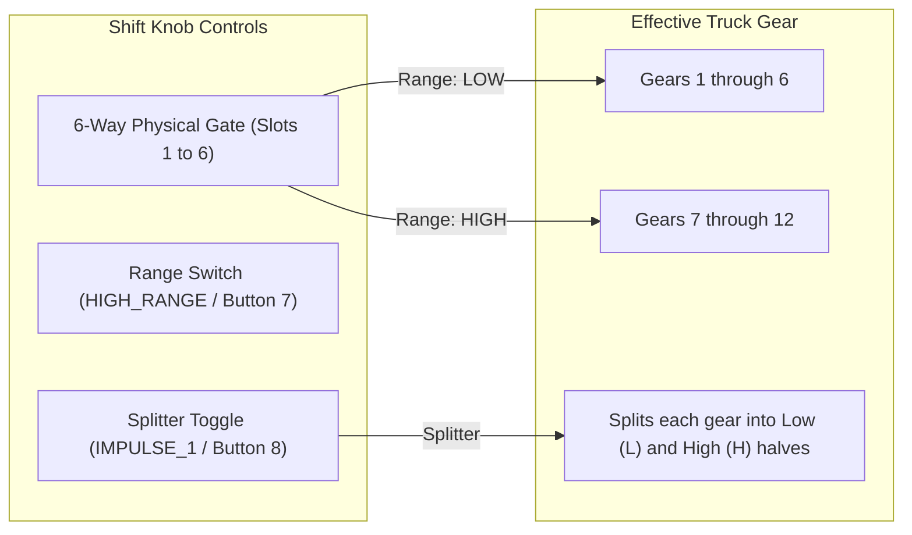

# Euro Truck Simulator 2 (ETS2) & ATS Setup Guide

This guide covers the configuration of the **GearShifterForMargus** controller for **Euro Truck Simulator 2 (ETS2)** and **American Truck Simulator (ATS)**, including H-shifter transmission layouts (Range & Splitter), pedal axes, and Windows Force Feedback tuning.

---

> [!IMPORTANT]
> **Force Feedback Operating System Notice:**
> Force feedback (road rumble, steering resistance, engine vibration, centering spring) currently works **only under Windows**. On Linux and macOS, the steering inputs, pedal axes, and gear shifter buttons will function normally, but FFB physics will not be output to the motor.

---

## 1. How Truck Transmissions Work with this Shifter

Real-world heavy commercial trucks feature complex 12-speed, 14-speed, 16-speed, or 18-speed transmissions (such as Scania Opticruise, Volvo I-Shift, ZF Ecosplit, and Eaton Fuller). 

Because physical sim shifters usually have 6 forward gate slots, trucks use two auxiliary switches mounted on the shift knob:



### Transmission Types
1. **Range-Only (e.g. Scania 12-Speed):**
   - **Low Range:** Gate positions 1 to 6 select Gears 1 through 6.
   - **High Range (Flip Range Switch UP):** Gate positions 1 to 6 select Gears 7 through 12.
2. **Range-Splitter (e.g. ZF 16-Speed or Scania 12+2):**
   - Combines Range selection (Low/High 4-gear blocks) with a Splitter toggle (halving each ratio into $1\text{L}, 1\text{H}, 2\text{L}, 2\text{H}, \dots$).

---

## 2. In-Game Controls Configuration (ETS2 / ATS)

Launch ETS2 or ATS and navigate to **Options > Controls**:

### Step 1: Controller Selection
- **Input device:** Select `Keyboard + Arduino Leonardo` (or `Joystick / Controller`).
- **Controller Subtype:** Set to **Wheel**.
- **Transmission:** Set to **H-Shifter**.

---

### Step 2: Steering & Pedals Axis Setup
Scroll down to the analog axis bindings:

| Axis in ETS2 | Assignment | Recommended Settings |
|---|---|---|
| **Steering Axis** | Turn wheel | Deadzone: `0%`, Linearity: `100% (slider far left)` |
| **Steering Axis Mode** | Centered | Normal |
| **Acceleration Axis** | Press throttle | Deadzone: `0%`, Inverted: Unchecked (or Inverted if needed) |
| **Brake Axis** | Press brake | Deadzone: `0%`, Inverted: Unchecked |
| **Clutch Axis** | Press clutch | Deadzone: `0%`, Inverted: Unchecked |

> [!TIP]
> If a pedal axis bar is full when your foot is off the pedal, toggle the **Inverted** checkbox next to that axis in ETS2 until the bar fills up only when pressed down.

---

### Step 3: H-Shifter Layout Setup
Scroll to the **H-Shifter Setup** section:

1. **Shifter Layout:** 
   - For 12-speed trucks: Choose **Range** or **Scania 12-speed**.
   - For 16-speed trucks: Choose **ZF 16-speed** or **Range-Splitter**.
2. **Shifter Layout Behavior:** 
   - Set to **Advanced** (prevents gear grinding when shifting without the clutch).
3. **Fast Split (Range / Splitter):** 
   - Set to **Clutch or Throttle** or **Clutch only** (matches real pneumatic shift behavior).

---

### Step 4: Shifter Position & Toggle Assignments

Click each entry to map the physical switch:

| In-Game Setting | Code Button Symbol | Windows Joystick Button |
|---|---|---|
| **Shifter Position 1** | `NORMAL_1` | Button 0 |
| **Shifter Position 2** | `NORMAL_2` | Button 1 |
| **Shifter Position 3** | `NORMAL_3` | Button 2 |
| **Shifter Position 4** | `NORMAL_4` | Button 3 |
| **Shifter Position 5** | `NORMAL_5` | Button 4 |
| **Shifter Position 6** | `NORMAL_6` | Button 5 |
| **Shifter Reverse** | `REVERSE` | Button 6 |
| **Shifter Toggle 1 (Range)** | `HIGH_RANGE` | Button 7 |
| **Shifter Toggle 2 (Splitter)** | `IMPULSE_1` | Button 8 |

#### Configuring Switch Behavior
Directly below the toggle bindings in ETS2:
- **Shifter toggle use switch mode:**
  - **CHECKED (Enabled):** If your shifter knob has physical two-position latching toggle/rocker switches (the switch stays in the ON or OFF position).
  - **UNCHECKED (Disabled):** If your shifter knob uses momentary pushbuttons.

---

## 3. Force Feedback Configuration (Windows Only)

Under Windows, ETS2 provides rich physics-based force feedback. Recommended in-game sliders under **Options > Controls > Force Feedback**:

- **Force Feedback:** Checked (Enabled).
- **Overall Gain:** `70% – 85%` (Keep slightly below 100% to avoid clipping during high-speed cornering).
- **Centering at High Speed:** `30% – 50%` (Simulates caster angle centering).
- **Centering at Low Speed:** `40% – 60%` (Heavy feel when maneuvering in truck parking spots).
- **Internal Friction:** `15% – 25%` (Dampens sudden steering wheel twitching).
- **Engine Vibration:** `20% – 30%` (Subtle tactile idle rumble).
- **Terrain Surface / Bumps:** `40% – 60%` (Road textures and rumble strips).
- **Collisions:** `50%` (Force impulse on trailer/barrier impacts).

---

## 4. Profile Configuration File (`controls.sii`)

ETS2 and ATS store all device GUIDs, axis curves, button bindings, and deadzones inside a single profile file named `controls.sii`.

### Location on Windows
```text
%USERPROFILE%\Documents\Euro Truck Simulator 2\profiles\<profile_id>\controls.sii
```
*(Where `<profile_id>` is an alphanumeric folder name representing your active in-game driver profile).*

### Pre-Configured `controls.sii` Profile (Coming Soon)
A tested, fully tuned `controls.sii` file will be added to this repository by the maintainer. Once provided, it will allow you to instantly import:
- Exact pedal non-linear response curves.
- Ideal Force Feedback gain curves and damper levels.
- Pre-mapped 6-speed H-pattern, Reverse, Range, and Splitter bindings.

#### How to apply when the file is available:
1. Make a backup copy of your existing `controls.sii`.
2. Copy the repository's `controls.sii` into your profile folder:
   ```powershell
   Copy-Item "controls.sii" "$HOME\Documents\Euro Truck Simulator 2\profiles\<profile_id>\controls.sii"
   ```
3. Launch ETS2 and verify that the steering, pedals, and shifter buttons are populated automatically.

